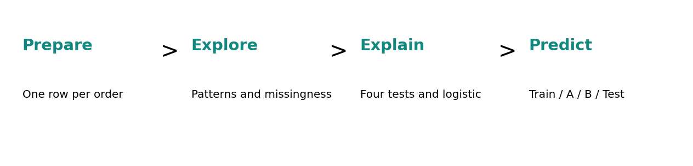
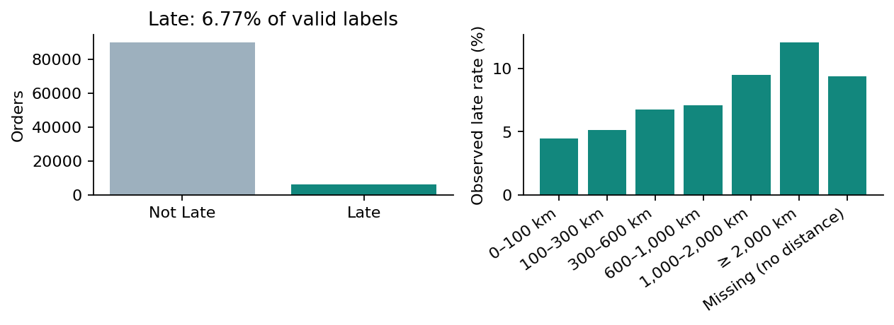
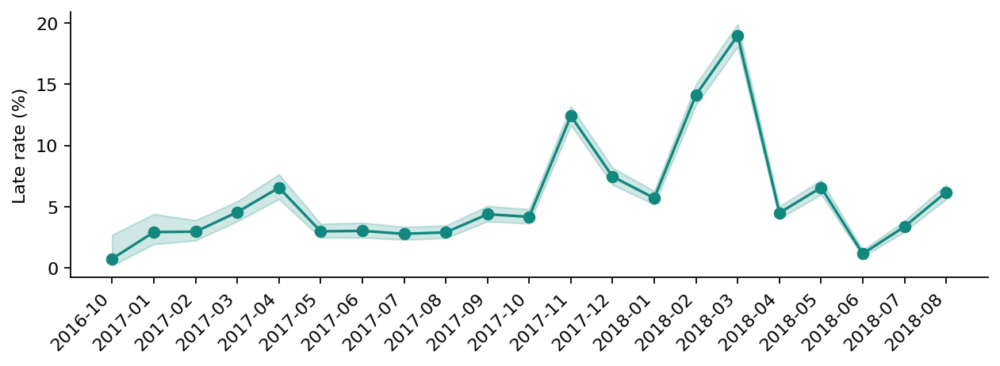
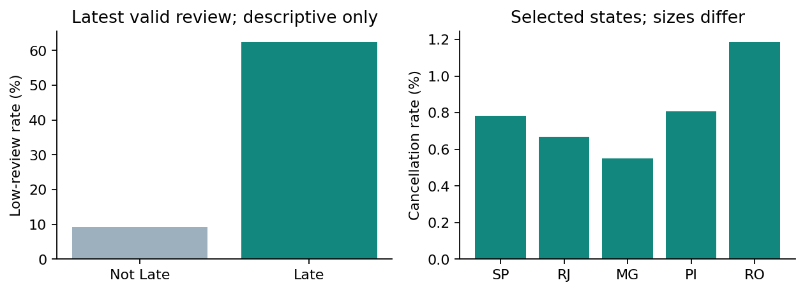
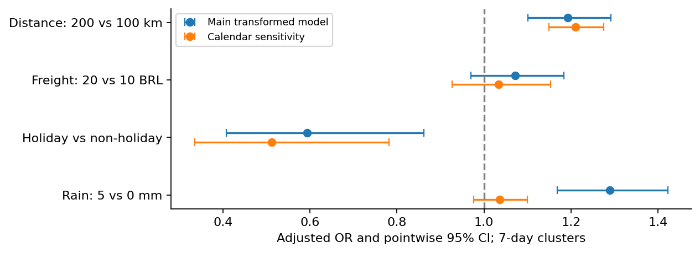
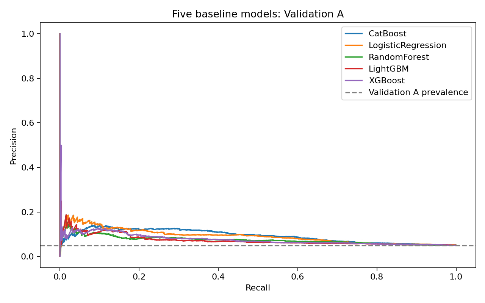
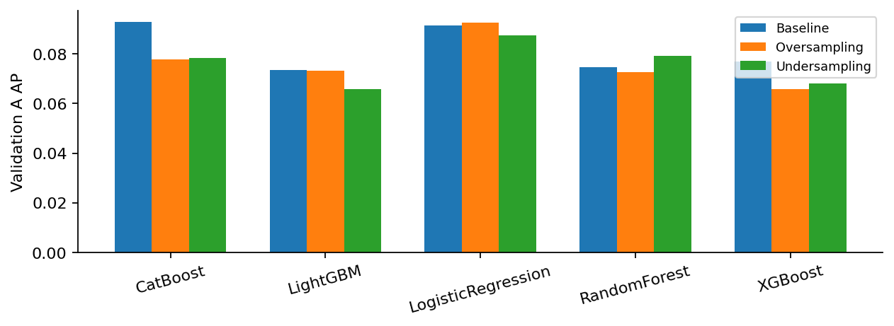
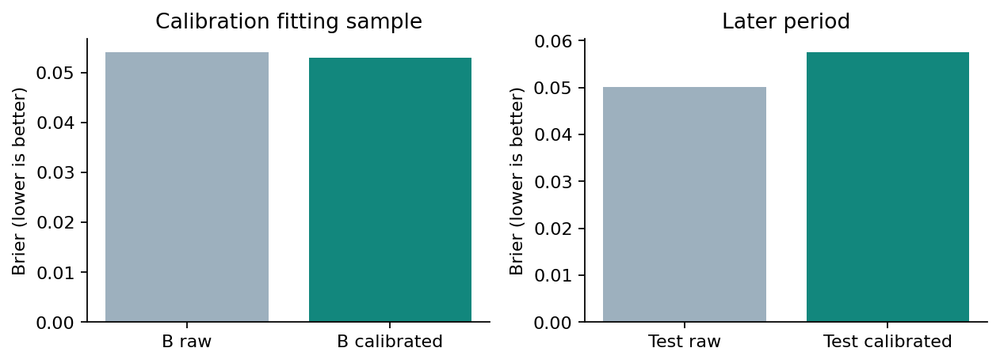
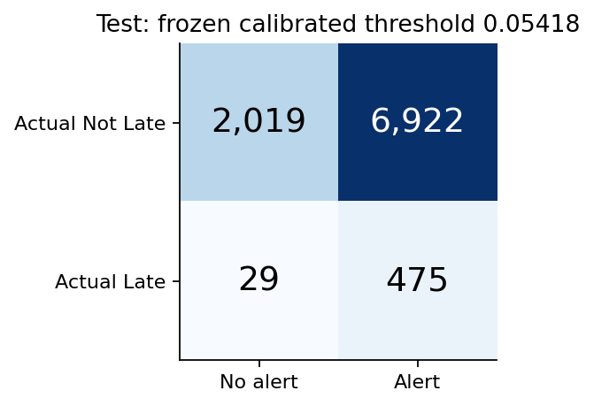

# Abstract

This study examines late delivery in the Brazilian Olist e-commerce dataset. It combines data preparation, exploratory analysis, four statistical tests, explanatory logistic regression and machine learning. The research table contains 99,441 orders, of which 96,470 have valid delivery labels. Late delivery accounts for 6.77% of labelled orders. Customer reviews and cancellation provide descriptive business context; they are not tested or modelled as additional outcomes.

Distance, freight, holiday purchases and pre-purchase rainfall show unadjusted differences after Holm correction. After adjustment, the freight contrast is unclear and the rainfall association is sensitive to calendar controls. Five learned classifiers are compared using temporal splits. CatBoost has the highest Average Precision on Validation A, at 0.0929. Sigmoid calibration improves probability quality on Validation B but worsens it on the later Test period. At the frozen threshold, Test recall is 94.25%, precision is 6.42%, and 78.32% of orders receive an alert. The results support further operational study, but not broad automatic deployment. The added predictive value of individual feature groups has not yet been tested.

Keywords: late delivery; Olist; logistic regression; class imbalance; calibration; temporal evaluation.

# Contents

1. Introduction

2. Literature Review and Research Gap

3. Data Description and Feature Engineering

4. Methodology and Experimental Design

5. Statistical and Exploratory Results

6. Modelling and Predictive Results

7. Discussion

8. Conclusion and Future Work

References

Appendix: Reproducibility and Output Guide

# 1. Introduction

## 1.1 Business Background

Reliable delivery is an important part of online shopping. A late order can create uncertainty for the customer and extra work for the seller or platform. An early risk score may help a team decide which orders need attention. However, a useful warning system must identify late orders without sending too many false alerts.

Olist provides order, customer, seller, product and review records for Brazilian e-commerce [4]. This project uses them to describe delivery patterns, examine selected associations and evaluate purchase-time prediction. Reviews and cancellation are studied separately to explain the business context.

## 1.2 Problem Statement

Orders differ in distance, product mix, price, freight and promised delivery time. Holidays and weather before purchase may add information. A factor can show statistical association without improving prediction on later orders. A model can also rank orders reasonably well while producing inaccurate probabilities or too many alerts. The study therefore separates description, statistical explanation and predictive evaluation.

## 1.3 Objectives and Research Questions

The objectives are to build a checked order-level dataset, describe delivery patterns, test four selected questions, estimate adjusted associations, compare predictive models and discuss practical limits. The five broad questions below organise the report; they are not five hypothesis tests.

Table 1.1. Main research questions

| ID | Question | Evidence |
| --- | --- | --- |
| A | How does late delivery vary across order characteristics, locations and time? | Descriptive EDA |
| B | Which selected variables are associated with late delivery? | Four unadjusted tests |
| C | Which associations remain after adjustment for other selected variables? | Explanatory logistic regression |
| D | Do price/product, holiday and weather features improve early prediction on later orders? | Feature-group experiment; not completed |
| E | How do review scores and cancellation patterns differ across groups? | Descriptive analysis only |

## 1.4 Scope

The main target is late delivery at the purchase-time decision point. Eligible delivered orders are labelled using actual and estimated calendar dates. The data are historical and observational. The results cannot establish that a feature causes delay or that a proposed action improves business performance. Seller assignment, freight quotes, delivery estimates and weather publication timing retain purchase-time availability assumptions.

# 2. Literature Review and Research Gap

## 2.1 Previous Studies

Muller and colleagues [1] review methods and data sources for predicting delivery delays, including readiness for practical use. This supports evaluating more than a single model score. Karakaya and Temizceri [2] present a conference abstract on Olist prediction using Logistic Regression, Random Forest and XGBoost, with attention to thresholds and SHAP explanations. It provides relevant context, but not a full matching benchmark. Sani and colleagues [3] study Bayesian-optimised LightGBM for backorder risk, which differs from this project's delivery target.

Table 2.1. Related work and relevance

| Source | Focus | Relevance and limit |
| --- | --- | --- |
| Muller et al. [1] | Delivery-delay methods and implementation | Motivates practical evaluation; not a score benchmark |
| Karakaya and Temizceri [2] | Olist prediction, thresholds and SHAP | Related conference abstract; different implementation |
| Sani et al. [3] | LightGBM for backorder risk | Related risk modelling; different outcome |

## 2.2 Research Gap and Contribution

The project combines order-level checks, business description, selected tests, adjusted regression and temporal evaluation. It also examines probability quality and alert volume. The contribution is an organised empirical workflow, not a new algorithm. Differences in targets, samples, features and evaluation designs prevent direct comparisons with published scores. External data are treated as candidate information, not as a confirmed improvement.

# 3. Data Description and Feature Engineering

## 3.1 Data Sources

The internal sources are Olist tables for orders, customers, items, sellers, products, payments, reviews and geolocation [4]. Product category translations support interpretation. A national holiday calendar and processed INMET observations provide external information [5]. Processed weather files are available locally, but the original annual INMET ZIP archives are missing from the current inputs. The complete weather extraction chain was not rerun for this report.

Table 3.1. Main data sources

| Source | Information | Role |
| --- | --- | --- |
| Olist relational tables | Order, customer, item, seller, product, payment and location records | Order-level data and internal predictors |
| Olist reviews | Scores and review timestamps | Retrospective description only |
| Brazil holiday calendar | National holiday dates | Calendar predictors |
| INMET observations | Pre-purchase weather summaries by state | External predictors; availability assumptions |

## 3.2 Preparation and Target Definition

The preparation checks duplicates, missing values, invalid numbers and inconsistent dates. Item, seller and product information is aggregated before joining so that each order appears once. Geolocation records form lookup information for distance. Merge checks confirm that order counts and unique identifiers are preserved. Unavailable values are not automatically replaced with zero.

For eligible delivered orders, is_late equals 1 when the actual delivery calendar date is later than the estimated calendar date, and 0 otherwise. Delivery on the estimated date is Not Late. Actual delivery must not precede purchase. Orders without a valid outcome remain in the research table but are excluded from analyses requiring a label. Cancelled and undelivered orders are not classified as Not Late.

## 3.3 Analysis Samples

Table 3.2. Samples used in the report

| Sample | Orders | Purpose |
| --- | --- | --- |
| Research table | 99,441 | One row per order |
| Valid delivery labels | 96,470 | Delivery EDA and question-specific tests |
| Late / Not Late | 6,534 / 89,936 | Class distribution |
| Without valid labels | 2,971 | Excluded from label-dependent analysis |
| Regression training complete cases | 56,553 | Adjusted associations |
| Labelled orders with selected review | 95,824 | Review description |
| Status/cancellation sample | 99,441 | Wider order population |

Each analysis uses the required nonmissing inputs. Distance retains 95,990 orders and destination rainfall retains 95,544; freight and holiday tests use all 96,470 labelled orders. Regression excludes 896 training orders lacking at least one main predictor. The excluded group has a higher late percentage than the retained group, so complete-case selection may affect the estimates.

## 3.4 Feature Groups and Quality

Table 3.3. Shared predictive feature groups

| Group | Predictors | Availability note |
| --- | --- | --- |
| Basic and temporal (7) | Distance, state, item count, seller count, hour, weekday, estimated window | Seller information and estimate assumed available |
| Price/product (5) | Item value, freight, weight, volume, category count | Quoted values and attributes assumed available |
| Holiday (3) | Purchase holiday, days to next holiday, holidays in estimated window | Known calendar; window depends on estimate |
| Weather (6) | Origin/destination rainfall, humidity and temperature | Pre-purchase observations; publication time unverified |

The learned baseline models use the same 21 predictors. Other engineered ratios support EDA but are not all model inputs. ML preprocessing is fitted only on Train. Explanatory regression instead uses complete cases. Detailed missingness and feature roles are recorded in the repository dictionaries and predictor list.

The main scenario assumes UTC. A separate Sao Paulo scenario exists, but the versions are not stacked as extra orders. Weather is a state-level pre-purchase index, not weather at an exact address or along the delivery route. Historical values may not have been published by prediction time. Reviews, actual delivery timestamps and actual delay duration are excluded from early predictors.

# 4. Methodology and Experimental Design

## 4.1 Framework

Five stages are used: preparation, EDA, testing, adjusted regression and predictive evaluation. Reviews and cancellation remain descriptive. Significance is not used alone to select predictors. Functional forms and reporting scope were revised after earlier data inspection, so inference is exploratory rather than prospectively registered.

Figure 4.1. Research workflow. Explanation and prediction answer different questions.

## 4.2 Descriptive Analysis

Categorical variables are summarised by counts and percentages; numerical variables by means, medians and quartiles. Late rates use valid labels as the denominator. Monthly plots include pointwise Wilson 95% intervals and mark small groups. Large values are inspected rather than removed only because they are extreme.

For the review results in this report, one latest valid review is selected by creation date, then answer timestamp and review ID. Scores 1-2 are low reviews. Missing reviews remain missing and coverage is shown by delivery label. Earlier first-review EDA outputs have slightly different percentages; the report uses the latest-valid-review summary consistently. Cancellation is the observed status "canceled", described using the wider order sample.

## 4.3 Four Inferential Questions

Table 4.1. Primary inferential design

| RQ | Null hypothesis | Method and effect |
| --- | --- | --- |
| RQ1: distance | The two distributions are identical | Mann-Whitney U; rank-biserial and bootstrap CI |
| RQ2: freight | The two means are equal | Welch t-test; Late minus Not Late mean, BRL |
| RQ3: holiday purchase | The two late rates are equal | Chi-square or Fisher; holiday minus non-holiday risk difference |
| RQ4: destination rain | The two means are equal | Seven-day block bootstrap; Late minus Not Late mean, mm |

All four tests are two-sided at alpha 0.05, with Holm correction across four primary p-values. Intervals remain pointwise 95%, not simultaneous. The former review test is excluded. This reduced scope follows earlier analyses and is disclosed rather than described as a prospective plan.

Mann-Whitney is not automatically a median test. Its stratified order-bootstrap interval does not account for seller/time clustering. Welch allows unequal variances but does not solve dependence; a 10% trimmed-mean sensitivity is supplementary. Binary tests check expected counts and use Fisher when needed. Rainfall uncertainty resamples whole calendar blocks across locations to preserve shared observations within each block. A null-centred bootstrap-error test and fourteen-day sensitivity are used. Cross-block dependence and finite-simulation error remain limitations.

## 4.4 Adjusted Logistic Regression

The outcome is is_late. The basic model includes distance, state, item count, seller multiplicity, weekday and estimated window. The full model adds item value, freight, weight, volume, purchase holiday, holiday count in the window and destination rain. Both use the same complete-case training sample. No review regression, class balancing or regularisation is included.

Initial forms are checked with VIF, residual plots, influence measures and monthly comparisons. The main reporting model retains previously developed log1p terms and a centred quadratic window term. Calendar adjustment is supplementary. Main uncertainty uses 65 seven-day clusters; sensitivity uses 35 fourteen-day clusters. Finite-sample correction and t inference use clusters minus one degrees of freedom. Some covariance matrices are rank deficient, so full-model joint Wald tests are not reported. The four focal contrasts receive their own Holm correction.

## 4.5 Predictive Models and Splits

Logistic Regression, Random Forest, LightGBM, XGBoost and CatBoost are compared using the same temporal splits and predictors. Model-specific imputation, encoding and scaling are fitted only on Train. Baselines use seed 42 and the same split manifest, without class weighting, resampling, calibration or threshold tuning.

Table 4.2. Final temporal samples

| Split | Purchase period | Orders / Late | Role |
| --- | --- | --- | --- |
| train | 2016-09-15 to 2018-03-01 | 57,449 / 3,720 | Fit models |
| validation_a | 2018-04-16 to 2018-05-15 | 7,661 / 387 | Select classifier |
| validation_b | 2018-05-16 to 2018-06-03 | 3,115 / 180 | Calibration and threshold |
| test | 2018-07-19 to 2018-08-29 | 9,445 / 504 | Frozen evaluation |

The design uses 45-day gaps at selected boundaries and label-availability cutoffs; 18,800 labelled orders are excluded from the final samples. Training deliveries must be recorded before 16 April 2018, and validation labels satisfy the cutoff before Test. These rules reduce direct future-label leakage but also select the cohort. They do not establish purchase-time availability of every source. Validation B is fitting/selection data, not independent final assessment.

## 4.6 Metrics, Imbalance and Calibration

Average Precision (AP) is the primary ranking metric; ROC-AUC is supplementary. Brier and LogLoss assess probabilities and are better when lower. Precision, recall, F1 and alert rate assess a selected threshold. Accuracy alone is misleading when Not Late dominates. AP is not accuracy and depends on prevalence, so changes across temporal periods are not a controlled model comparison.

Weighted CatBoost and random sampling are additional experiments. Oversampling duplicates Late Train records until each class has 53,729 examples. Undersampling keeps 3,720 Late and randomly selects 3,720 Not Late examples. The same sampled indices are used across the five learned models. No validation or Test records are resampled. Sampling followed Test exposure and is exploratory, not a replacement for the frozen decision.

CatBoost selected on Validation A is held fixed. On B, sigmoid calibration is fitted to clipped log-odds, with epsilon 0.000001: p_calibrated = sigmoid(1.2082 * logit(p_raw) + 1.4934). The positive slope preserves ranking. A threshold is then chosen for recall at least 70%, maximising precision; ties favour lower alert rate and larger threshold. This is an experimental rule, not a business-validated requirement.

# 5. Statistical and Exploratory Results

## 5.1 Data Quality and Class Imbalance

The research table contains 99,441 unique orders. There are 96,470 valid delivery labels: 89,936 Not Late and 6,534 Late. The remaining 2,971 are not assigned to the negative class. Missing inputs are handled per question. The strong imbalance makes minority-class detection and false alerts important.

Figure 5.1. Label counts and distance-group late rates. These are descriptive, not causal comparisons.

## 5.2 Location and Time Patterns

The 0-100 km group has a late rate of 4.47%, compared with about 12.04% for distances of at least 2,000 km. Rio de Janeiro has about 12.11%, while Sao Paulo has 4.49%. Such differences can reflect order mix, sellers, distance and time, not geography alone.

The late rate is about 18.96% in March 2018 and 1.16% in June 2018. This variation supports temporal evaluation rather than a random split alone. It also warns that an alert threshold may not transfer across periods. Small or incomplete months should not be treated as reliable extremes.

Figure 5.2. Monthly late rates; months with fewer than 100 valid labels are omitted. Shading shows pointwise Wilson 95% intervals.

## 5.3 Reviews and Cancellation: Descriptive Results

Table 5.1. Latest valid review by delivery label

| Label | Reviewed orders | Low reviews | Low-review rate | Mean score |
| --- | --- | --- | --- | --- |
| Not Late | 89,443 | 8,290 | 9.27% | 4.29 |
| Late | 6,381 | 3,982 | 62.40% | 2.27 |

Among orders with a selected valid review, 62.40% of Late orders receive 1-2 stars, compared with 9.27% of Not Late orders. The observed difference is 53.14 percentage points. Mean scores are about 2.27 and 4.29. These are descriptive associations, not the effect of causing or preventing delay. Missing reviews are more common for Late orders: 2.34%, compared with 0.55%. Coverage and selection may affect the comparison.

There are 625 cancelled orders among 99,441 orders, or 0.63%. Example cancellation rates are 0.78% in Sao Paulo (327/41,746), 0.67% in Rio de Janeiro (86/12,852), and 1.19% in Rondonia (3/253). A high percentage based on a few events is not a stable ranking. No review or cancellation significance test is claimed.

Figure 5.3. Review and selected cancellation rates. Panels use different samples; both are descriptive only.

## 5.4 Four Hypothesis Tests

Table 5.2. Four primary tests; pp means percentage points

| RQ | n | Estimate | Pointwise 95% CI | Raw p | Holm p |
| --- | --- | --- | --- | --- | --- |
| RQ1 | 95,990 | 0.160 rank-biserial | [0.146, 0.173] | 1.98e-102 | 7.92e-102 |
| RQ2 | 96,470 | 2.641 BRL | [2.049, 3.233] | 2.71e-18 | 8.13e-18 |
| RQ3 | 96,470 | -1.928 pp | [-2.927, -0.698] | 0.00344 | 0.00344 |
| RQ4 | 95,544 | 1.314 mm | [0.794, 1.767] | 0.0005 | 0.001 |

All four null hypotheses are rejected at 0.05 after Holm. Rank-biserial is about 0.160, indicating higher distance ranks for Late orders. Mean freight is 2.64 BRL higher among Late orders. Holiday purchases have a late rate 1.93 percentage points lower than non-holiday purchases. The destination rainfall index is 1.31 mm higher in the Late group. Effects with different units should not be ranked directly. Statistical significance alone does not establish a large business effect.

These are unadjusted comparisons. Order mix and time patterns can contribute to differences. The rainfall p-value is a finite-simulation approximation. All CIs are pointwise, and supplementary freight/rainfall sensitivity does not enlarge the four-test family.

# 6. Modelling and Predictive Results

## 6.1 Adjusted Delivery Associations

Table 6.1. Main transformed delivery model, seven-day clusters

| RQ | Contrast | Adjusted OR | Pointwise 95% CI | Holm p |
| --- | --- | --- | --- | --- |
| RQ1 | 200 vs 100 km | 1.193 | [1.101, 1.292] | 0.000128 |
| RQ2 | 20 vs 10 BRL | 1.071 | [0.970, 1.183] | 0.17 |
| RQ3 | Holiday vs non-holiday | 0.593 | [0.408, 0.862] | 0.0138 |
| RQ4 | 5 vs 0 mm rainfall index | 1.290 | [1.168, 1.423] | 1.06e-05 |

Distance of 200 versus 100 km has OR 1.19, with CI about [1.10, 1.29]. This is an odds comparison, not a 19 percentage-point probability increase. Freight has OR 1.07 for 20 versus 10 BRL, but its CI includes 1. There is not clear evidence for this contrast after adjustment, which does not prove absence of a relationship in every setting.

Holiday purchases have OR 0.59 relative to non-holiday purchases. This is not evidence that ordering on a holiday prevents delay. Rainfall of 5 versus 0 mm has OR 1.29 in the main model, but about 1.04 [0.98, 1.10] after calendar adjustment. The weather result is therefore sensitive to time controls and should not be presented as a stable causal finding.

Figure 6.1. Main and calendar-adjusted delivery contrasts. CIs use seven-day clusters and are pointwise.

The delivery fits converged. Diagnostics include VIF, residual patterns, influence and covariance ranks. Calendar adjustment improves training fit but was developed after inspection. Rank deficiency and residual dependence limit joint inference. These checks do not establish correct form or predictive reliability. Stage 3 and Stage 4 also use different samples and estimands, so differences are not due only to adjustment.

## 6.2 Selection on Validation A

Table 6.2. Unweighted baselines on Validation A

| Model | AP | ROC-AUC | Brier | LogLoss |
| --- | --- | --- | --- | --- |
| CatBoost | 0.0929 | 0.6558 | 0.04723 | 0.19260 |
| LogisticRegression | 0.0916 | 0.6424 | 0.04772 | 0.19641 |
| XGBoost | 0.0768 | 0.5967 | 0.04798 | 0.19980 |
| RandomForest | 0.0748 | 0.6041 | 0.04819 | 0.20089 |
| LightGBM | 0.0736 | 0.5825 | 0.04819 | 0.20136 |

CatBoost has the highest AP, 0.09285, and the lowest baseline Brier and LogLoss on A. Logistic Regression is close at AP 0.09164. CatBoost is selected under the primary AP rule. The difference is only about 0.00122 and has no estimated uncertainty interval, so a clear population advantage is not established.

Figure 6.2. Baseline AP on Validation A. CatBoost leads slightly; uncertainty in model differences has not been estimated.

## 6.3 Later Test Comparison

Table 6.3. Saved Test results using raw probabilities

| Model / configuration | AP | ROC-AUC | Brier | LogLoss |
| --- | --- | --- | --- | --- |
| RandomForest | 0.0978 | 0.7038 | 0.04992 | 0.20042 |
| LightGBM | 0.0890 | 0.6770 | 0.05034 | 0.20128 |
| XGBoost | 0.0877 | 0.6820 | 0.05059 | 0.20083 |
| CatBoost | 0.0828 | 0.6741 | 0.05014 | 0.20085 |
| LogisticRegression | 0.0812 | 0.6299 | 0.05118 | 0.20698 |
| CatBoostWeighted | 0.0739 | 0.6247 | 0.17690 | 0.53512 |

Random Forest has the highest observed Test AP, 0.09781. CatBoost has AP 0.08284 and AUC 0.67409. The selected model is not changed using Test. The ranking difference shows variation across periods, not permission to optimise again on the same Test set. EDA and inference had already inspected the full labelled data, so Test was not completely unseen in the broader research process.

## 6.4 Added Value of Feature Groups

The controlled feature-group experiment has not been completed. Baselines use all 21 predictors. Comparing algorithms with this full set does not establish the added value of price/product, holiday or weather groups. No numeric result or claim of improvement is reported for this unfinished task.

A future comparison should hold CatBoost settings, Train rows, evaluation rows and preprocessing rules fixed while testing Basic, Basic plus each group, Full, and Full minus each group. Report AP differences with temporal uncertainty estimates. Current validation and Test have already been inspected; a new untouched period is required for independent confirmation.

## 6.5 Imbalance Experiments

Weighted CatBoost assigns Late a weight of about 14.44 relative to Not Late. Validation A AP drops from 0.09285 to 0.07915 and Brier rises from 0.04723 to 0.15942, so it is not selected. Balancing the loss does not automatically improve ranking or probability quality.

Table 6.4. Validation A AP under sampling

| Model | Baseline | Oversampling | Undersampling |
| --- | --- | --- | --- |
| CatBoost | 0.0929 | 0.0777 | 0.0784 |
| LightGBM | 0.0736 | 0.0732 | 0.0660 |
| LogisticRegression | 0.0916 | 0.0926 | 0.0876 |
| RandomForest | 0.0748 | 0.0727 | 0.0793 |
| XGBoost | 0.0768 | 0.0659 | 0.0681 |

Sampling gives no consistent AP improvement. Random Forest improves modestly with undersampling, while Logistic Regression improves slightly with oversampling. CatBoost worsens under both. Brier and LogLoss worsen for all five learned models under both methods in these runs. These are exploratory findings after Test exposure, not a replacement model selection.

Figure 6.3. Sampling results on Validation A. Only Train is resampled; later samples retain their observed class distributions.

## 6.6 Calibration and Threshold on Validation B

Table 6.5. CatBoost probability quality on B and Test

| Period / probability | Mean probability | Brier | LogLoss |
| --- | --- | --- | --- |
| B / raw | 2.75% | 0.05410 | 0.21686 |
| B / calibrated | 5.78% | 0.05295 | 0.20294 |
| Test / raw | 5.23% | 0.05014 | 0.20085 |
| Test / calibrated | 11.81% | 0.05752 | 0.22789 |

B contains 3,115 orders and 180 Late cases, or 5.78%. Mean raw probability is 2.75%. After sigmoid calibration, it is 5.78%; Brier improves from 0.05410 to 0.05295 and LogLoss from 0.21686 to 0.20294. Matching the mean alone does not establish reliability in every risk group. These are fitting results on B. AP and AUC remain 0.13176 and 0.74793 because ranking is unchanged.

The calibrated threshold is 0.054178902872422004. On B, precision is 10.97%, recall 71.11%, F1 0.19005 and alert rate 37.46%. It flags 1,167 orders: 128 true alerts and 1,039 false alerts, with 52 Late orders missed. It meets the experimental recall target but already creates substantial work. B is used for calibration fitting and threshold selection, so these are not independent evaluation results.

Figure 6.4. Brier before and after calibration. B is fitting data; Test is later data. The correction does not transfer well.

## 6.7 Frozen Pipeline on Test

Table 6.6. Results at the unchanged calibrated threshold

| Period | Precision | Recall | F1 | Alert rate | TP / FP / FN / TN |
| --- | --- | --- | --- | --- | --- |
| B | 10.97% | 71.11% | 0.1901 | 37.46% | 128 / 1039 / 52 / 1896 |
| Test | 6.42% | 94.25% | 0.1202 | 78.32% | 475 / 6922 / 29 / 2019 |

Test contains 9,445 orders and 504 Late cases, or 5.34%. Raw CatBoost mean probability is 5.23%, while the calibrated mean is 11.81%. Calibration worsens Brier from 0.05014 to 0.05752 and LogLoss from 0.20085 to 0.22789. The B-fitted correction does not transfer reliably to this period.

At the unchanged threshold, Test recall is 94.25%, but precision is only 6.42% and F1 is 0.12024. It flags 7,397 orders, or 78.32% of Test: 475 true alerts and 6,922 false alerts. It misses 29 Late orders. High recall alone therefore hides a large operational burden. The pipeline is an experimental reference, not a deployment-ready warning system.

Figure 6.5. Test confusion matrix at the frozen B-selected threshold. False alerts dominate the workload.

# 7. Discussion

## 7.1 Answers to the Research Questions

Table 7.1. Answers and evidence limits

| Question | Answer |
| --- | --- |
| A | Delivery rates vary across distance, states and months; these are descriptive patterns. |
| B | All four selected tests reject after Holm; effects have different units and practical sizes. |
| C | Distance and holiday associations remain in examined models. Freight is unclear; rain is calendar-sensitive. |
| D | Not yet answered by controlled feature-group comparisons. Full-feature algorithm comparison is insufficient. |
| E | Late orders have more low reviews and lower scores in the observed sample. Cancellation varies descriptively; no review/cancellation inference is claimed. |

## 7.2 Comparison with Previous Studies

The project follows related work in using order information and several classifiers [1,2]. Its results highlight the need to evaluate probabilities and thresholds separately. It does not establish that an algorithm is generally best. Different targets, samples and designs prevent direct score comparisons. The backorder study [3] concerns another outcome, and the conference abstract [2] does not provide a full matching evaluation design.

## 7.3 Business Implications

Low reviews are much more common among observed Late orders. This supports investigating early customer communication and follow-up, but does not prove that an intervention will raise scores. A controlled pilot is needed to measure benefits. Review selection and missingness should be considered before generalising.

The distance association supports reviewing promises and operating capacity on longer routes. It does not justify a universal distance cutoff. Route, seller and period audits could identify groups with both a high rate and a large number of affected orders. Freight should not be treated as a simple proxy for service speed. Weather and holiday patterns also need caution: calendar controls change rainfall results and lower holiday odds do not imply a protective effect.

The current threshold would require staff to inspect most Test orders. A pilot should first set a daily review budget, then measure precision at a fixed top-K, Late cases detected and staff workload. Thresholds should be developed using suitable development data and confirmed later, not retuned on the existing Test. No financial return or intervention effect has been measured.

## 7.4 Limitations

Historical data may not represent current operations. Label eligibility, delivery cutoffs, complete-case selection and review availability limit representativeness. Seller and spatial dependence may remain after temporal clustering. The scope and functional forms follow data inspection, and pointwise intervals do not account for all exploratory decisions.

Some purchase-time availability assumptions are unverified. State-level weather does not measure route exposure, source publication timing is uncertain, and a full-year station inventory can create a point-in-time concern. UTC is assumed and predictive timezone sensitivity is not completed. Original annual weather archives are missing.

EDA and inference inspected the full labelled cohort, and sampling followed Test exposure. Test was therefore not completely untouched by project exploration. Calibration and threshold selection share B, making B results optimistic for independent performance. No feature-group ablation or formal uncertainty interval for model AP differences is available. These limits accompany all conclusions.

# 8. Conclusion and Future Work

## 8.1 Main Conclusions

The study provides a checked order-level workflow. Late delivery is a minority outcome at 6.77% and varies by distance, location and time. Four unadjusted tests show differences, while regression gives a more qualified picture: freight is unclear and rainfall is calendar-sensitive. Review differences are important descriptive business findings; cancellation remains a separate descriptive outcome.

CatBoost leads Validation A AP, but its advantage over Logistic Regression is small and the Test ranking differs. Balancing does not improve results consistently. Calibration improves B but worsens Test probabilities. The frozen threshold combines high recall with low precision and excessive alerts. These findings support further investigation, not broad automatic deployment.

## 8.2 Future Work

The first research task is a controlled feature-group comparison for question D, followed by confirmation on a new period. Further work can study route and seller patterns, review scores by delay severity and thresholds based on operational capacity. Better purchase-time operational signals and verified weather availability may help, but gains must be measured. A controlled pilot should monitor delay, customer outcomes, workload and costs.

# References

[1] Muller, N., Burggraf, P., Steinberg, F., Sauer, C. R., and Schutz, M. (2025). An analytical review of predictive methods for delivery delays in supply chains. Supply Chain Analytics, 11, 100130. https://doi.org/10.1016/j.sca.2025.100130

[2] Karakaya, I., and Temizceri, T. (2026). From Prediction to Explanation: SHAP-Based Delivery Delay Analytics for e-Commerce Last-Mile Logistics. ITTA 2026 Abstracts, p. 181. Conference abstract. https://itta.cyber.az/2026/Abstracts_ITTA2026_2026-04-14.pdf

[3] Sani, S., Xia, H., Milisavljevic-Syed, J., and Salonitis, K. (2023). Supply Chain 4.0: A Machine Learning-Based Bayesian-Optimized LightGBM Model for Predicting Supply Chain Risk. Machines, 11(9), 888. https://doi.org/10.3390/machines11090888

[4] Olist. Brazilian E-Commerce Public Dataset by Olist. Kaggle. https://www.kaggle.com/datasets/olistbr/brazilian-ecommerce

[5] Instituto Nacional de Meteorologia (INMET). Dados historicos anuais. https://portal.inmet.gov.br/dadoshistoricos

# Appendix: Reproducibility and Output Guide

Table A.1. Repository evidence

| Component | Location |
| --- | --- |
| Data and features | data/processed/; docs/predictor_list.csv; docs/data_preprocessing/ |
| Splits | data/ml_preparation/split_manifest.csv and split_summary.csv |
| Four tests and review description | notebooks/03_inferential_statistics/; outputs/tables/inferential_statistics/ |
| Adjusted delivery associations | notebooks/04_explanatory_regression/; outputs/tables/explanatory_regression/four_rq_*.csv |
| ML comparison and sampling | notebooks/05_machine_learning/; outputs/tables/machine_learning/ |
| Calibration and threshold | ml_calibration/20261111_154951_108593/ |
| Test evaluation | ml_test/20261111_160038_411032/ |
| Sampling summary | ml_random_undersampling/20261111_161215_292137/sampling_method_comparison.csv |

Stage 3 and Stage 4 were rerun for the four-question scope. The report uses saved ML results; classifiers, calibration and Test scoring were not rerun to write it. Source data are preserved. Root requirements.txt records dependencies. Full sensitivity and diagnostic outputs remain in the repository. Tables are rounded for reading; CSVs retain more precision. Rebuilding weather from its original source requires the missing annual archives.
